# Runvane

**Fix it faster.** A public problem-solving platform for DevOps engineers, DevSecOps, solution architects, programmers, Linux administrators, database administrators and cloud engineers.

Live: **https://hub.3-131-57-88.sslip.io**

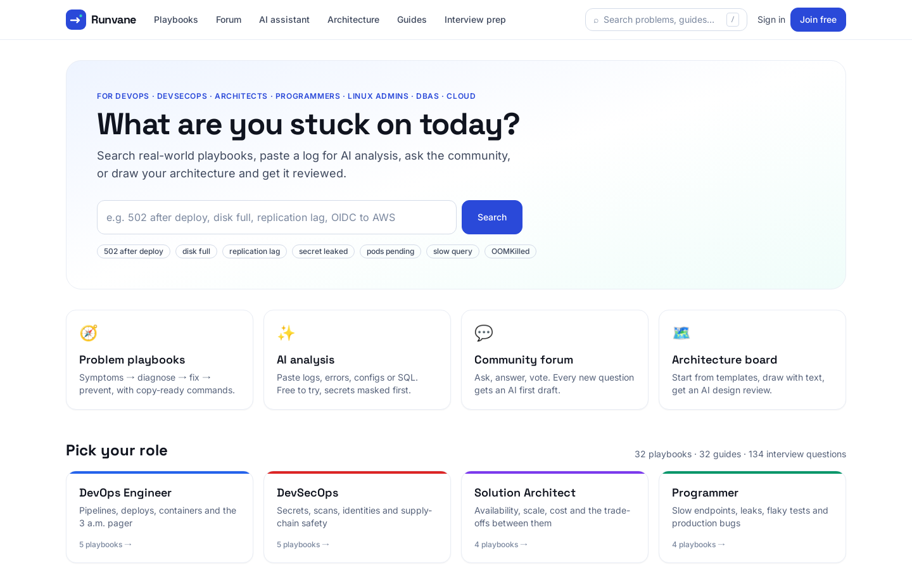

## What you can do

| Feature | What it gives you |
| --- | --- |
| **Problem playbooks** | Real day-to-day problems per role: symptoms → likely causes → diagnosis commands → fix → prevention, with copy buttons |
| **Search** | One typo-tolerant search (Meilisearch) over playbooks, guides, questions, glossary, interview questions and public boards. Press `/` anywhere |
| **AI assistant** | Ask anything (answers cite Runvane's own pages), or paste logs, errors, configs, SQL, Dockerfiles or pipelines for analysis. **Secrets are masked before anything is sent.** Visitors get free questions without an account |
| **Community forum** | Ask, answer, vote, accept, comment, report. Every new question gets a clearly labelled AI first draft |
| **Architecture board** | Diagram as code with live preview, 6 templates, describe-to-diagram, and an AI design review scored on reliability, security, performance, cost and operations |
| **Guides** | 32 guides from Linux and networking to Kubernetes, CI/CD, DevSecOps and architecture, each with a plain-words summary, best practices, common mistakes and recommendations |
| **Cloud services explained** | AWS (29), Azure (22) and Google Cloud (18) services in plain words, with equivalents across clouds, a starter command and a best practice, plus a side-by-side "which service should I use?" map |
| **Interview prep** | 134 questions with model answers, Junior → Senior, with quiz mode; 103-term glossary |

## Screenshots

| Playbook (dark) | Cloud comparison |
| --- | --- |
| 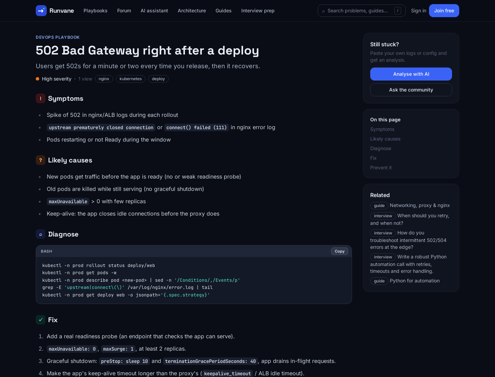 | 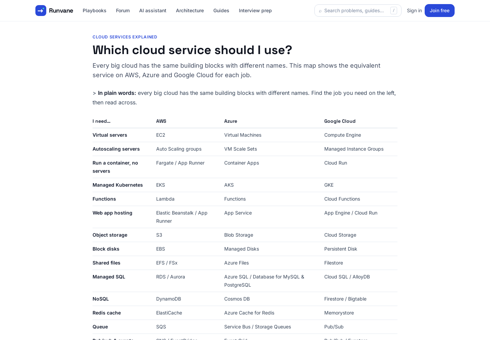 |

| AWS services explained | Guides |
| --- | --- |
| 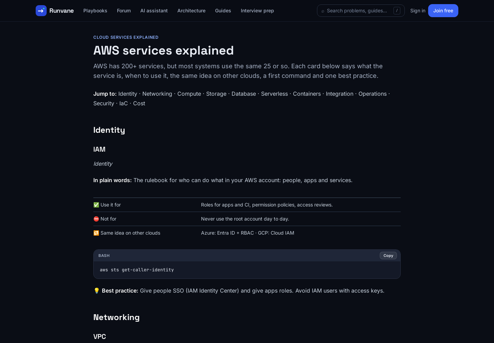 | 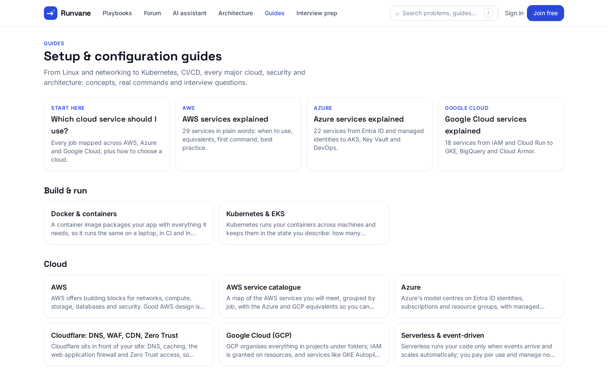 |

| AI assistant | Architecture board |
| --- | --- |
| 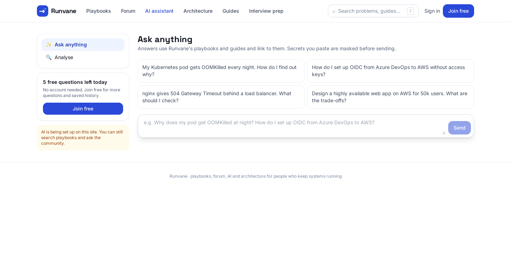 | 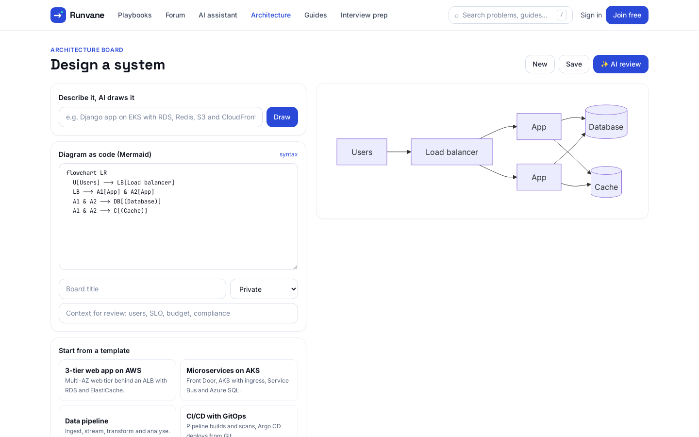 |

| Forum | Interview prep (dark) |
| --- | --- |
| 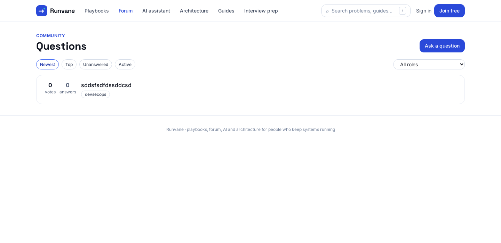 | 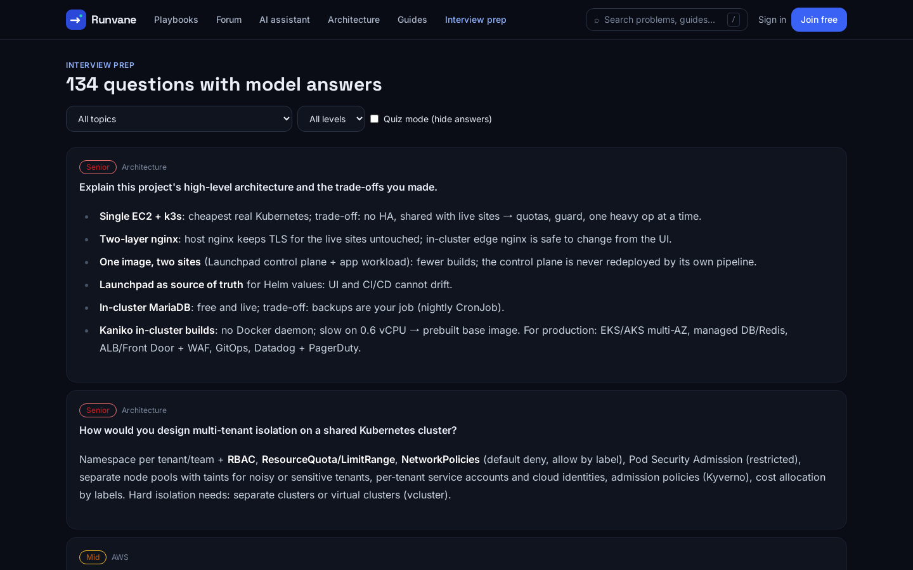 |

| Home on a phone | Playbook on a phone (dark) |
| --- | --- |
| 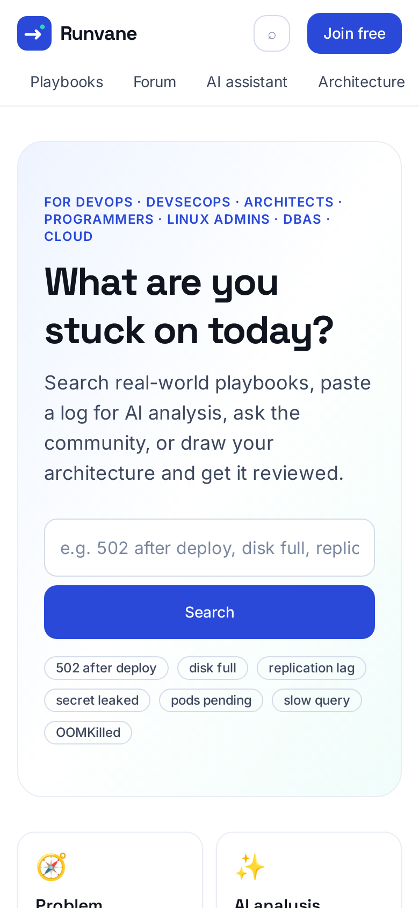 | 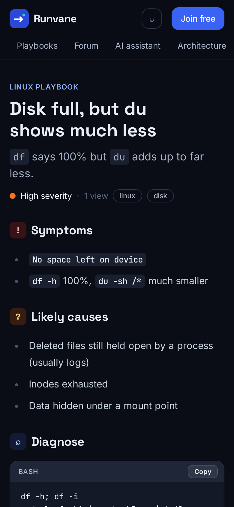 |

## How it works

```
Browser ─HTTPS─► host nginx (TLS, rate limits)
                   └─► Docker Compose "stackpilot"
                         web (gunicorn + nginx sidecar, Vue 3 SPA) · socketio · worker · scheduler
                         MariaDB · Redis · Meilisearch
                         AI gateway ─► Claude │ Gemini │ Groq │ OpenAI │ member's own key
```

- **Backend:** Frappe v16 app (`stackpilot` package; modules `sp_core`, `sp_knowledge`, `sp_forum`, `sp_ai`, `sp_studio`, `sp_tools`).
- **Frontend:** Vue 3 + Vite + Tailwind in `frontend/`, served at `/` by the Frappe page `www/spa`.
- **AI safety and cost:** secret masking (`sp_ai/utils/masking.py`), visitor allowance per IP per day, member daily token quota, monthly site budget that switches to members' own keys when reached, usage log per call.
- **Content:** seed data in `stackpilot/seed/` (playbooks, guides, glossary, interview); guide sources in `content_src/`. Seeding inserts what is missing and refreshes guides nobody edited.

## Run it

```bash
cd deploy
cp env.example .env                      # set DB_ROOT_PASSWORD, ADMIN_PASSWORD, MEILI_KEY
docker build -f Containerfile -t stackpilot:latest ..
docker compose up -d mariadb redis meilisearch
docker compose --profile setup run --rm init   # create site, seed content, build search index
docker compose up -d
```

Put `deploy/nginx-hub.conf` and `deploy/stackpilot-proxy.inc` in host nginx and get a certificate. Then sign in as `Administrator` at `/login` and add AI provider keys at `/app/ai-settings`.

**Update a running server** (only rebuilds the app layer):

```bash
cd /opt/stackpilot/src && git pull
docker tag stackpilot:latest stackpilot:prev
docker build -f deploy/Containerfile.update -t stackpilot:latest .
cd .. && docker compose up -d && docker compose --profile setup run --rm migrate
```

Roll back: `docker tag stackpilot:prev stackpilot:latest && docker compose up -d`.

## Tests

```bash
bench --site <site> set-config allow_tests true
bench --site <site> run-tests --app stackpilot
```

Covers secret masking, search ids, forum rules and reputation, junk-title detection, the AI budget cap, the no-keys path and the visitor allowance.

## License

MIT
